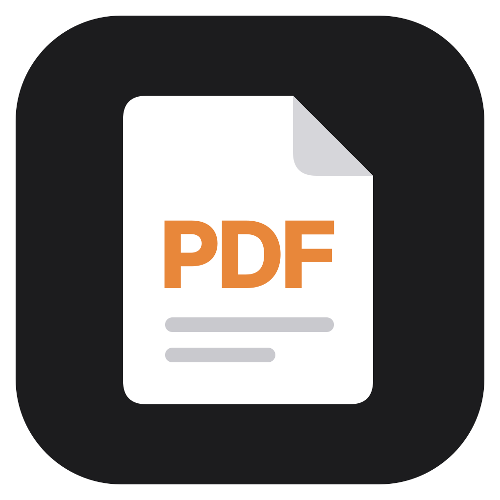
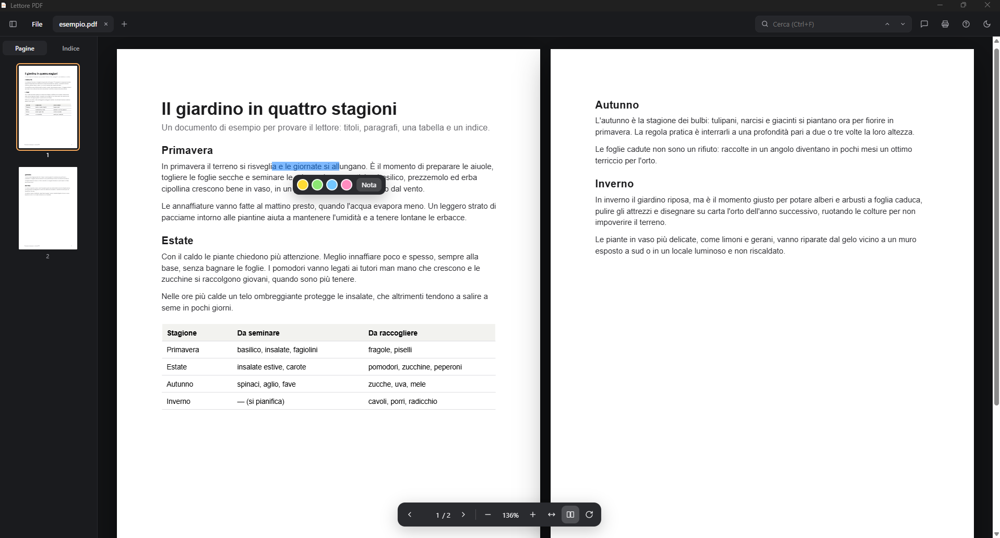

<p align="center">
  
</p>

<h1 align="center">Lettore PDF</h1>

<p align="center">
  Un lettore PDF leggero, senza pubblicità e senza account, per Windows e Mac.<br>
  <em>A lightweight PDF reader with no ads and no account, for Windows and Mac.</em><br>
  <a href="#english">English below ↓</a>
</p>

<p align="center">
  
</p>

---

## Italiano

Lettore PDF nasce per sostituire i lettori pieni di pubblicità, abbonamenti e funzioni che non servono. Fa poche cose, bene, e non manda nessun dato da nessuna parte: tutto resta sul tuo computer.

### Cosa fa

- **Legge** PDF di qualsiasi dimensione, in scorrimento continuo, con miniature e indice del documento
- **Schede**: più PDF aperti insieme; ogni file si riapre alla pagina dove l'avevi lasciato
- **Ricerca** nel testo con tutte le occorrenze evidenziate
- **Evidenziazioni e note** in quattro colori, salvate **dentro il PDF**: le vedi anche in Acrobat, Edge e negli altri lettori
- **Stampa**, rotazione, una o due pagine affiancate, adatta alla larghezza o alla pagina intera
- **Testo selezionabile** e link cliccabili
- **PDF protetti da password**
- Tema chiaro e scuro, interfaccia in **italiano e inglese**
- File recenti con anteprima

### Installazione

Scarica l'ultima versione dalla pagina **[Releases](../../releases)**:

- **Windows**: `Lettore PDF_x.x.x_x64-setup.exe`
- **Mac**: `Lettore PDF_x.x.x.dmg`

**Windows mostra un avviso blu ("Windows ha protetto il PC").** Succede perché l'app non ha una firma digitale a pagamento, non perché sia pericolosa: il codice è tutto qui, pubblico. Clicca **Ulteriori informazioni → Esegui comunque**.

**Su Mac** la prima apertura viene bloccata per lo stesso motivo: vai in **Impostazioni di Sistema → Privacy e sicurezza** e scegli **Apri comunque**.

Per aprire i PDF con doppio clic: tasto destro su un PDF → **Apri con** → **Lettore PDF** → "Usa sempre".

### Limiti noti

- La versione **Mac non è ancora stata provata** su un Mac vero: segnalaci qualsiasi problema.
- Nei PDF **protetti da password** non si possono ancora salvare note.
- Salvare note dentro un PDF **firmato digitalmente** rende la firma non più valida (l'app avvisa; usa "Salva con nome" per lasciare intatto l'originale).
- Non compila moduli e non modifica il testo del PDF.

### Segnalazioni e idee

Apri una **[Issue](../../issues)**: descrivi cosa è successo e, se puoi, allega uno screenshot.

### Per sviluppatori

Costruito con [Tauri 2](https://tauri.app) (Rust), HTML/CSS/JavaScript senza framework, [PDF.js](https://github.com/mozilla/pdf.js) e [pdf-lib](https://github.com/Hopding/pdf-lib).

```bash
# requisiti: Node.js LTS, Rust, e su Windows i Visual Studio Build Tools (C++)
npm install
npm run tauri dev     # versione di sviluppo
npm run tauri build   # installer
```

### Licenza

[MIT](LICENSE) © 2026 Ermanno Tasca. Componenti di terze parti: vedi [THIRD_PARTY_NOTICES.md](THIRD_PARTY_NOTICES.md).

---

<a id="english"></a>

## English

Lettore PDF ("PDF reader" in Italian) is an alternative to PDF readers full of ads, subscriptions and features nobody asked for. It does a few things well and sends no data anywhere: everything stays on your computer.

### Features

- **Reads** PDFs of any size, with continuous scrolling, thumbnails and the document outline
- **Tabs**: several PDFs open at once; each file reopens at the page where you left it
- **Search** with every match highlighted
- **Highlights and notes** in four colors, saved **inside the PDF**: they show up in Acrobat, Edge and other readers too
- **Print**, rotate, one or two pages side by side, fit width or whole page
- **Selectable text** and clickable links
- **Password-protected PDFs**
- Light and dark theme, **Italian and English** interface
- Recent files with previews

### Install

Download the latest version from **[Releases](../../releases)**:

- **Windows**: `Lettore PDF_x.x.x_x64-setup.exe`
- **Mac**: `Lettore PDF_x.x.x.dmg`

**Windows shows a blue warning ("Windows protected your PC").** That's because the app has no paid code-signing certificate, not because it's unsafe: all the code is here, in public. Click **More info → Run anyway**.

**On Mac** the first launch is blocked for the same reason: go to **System Settings → Privacy & Security** and choose **Open Anyway**.

To open PDFs with a double click: right-click a PDF → **Open with** → **Lettore PDF** → "Always use this app".

### Known limitations

- The **Mac version hasn't been tested** on a real Mac yet: please report any problem.
- Notes can't be saved into **password-protected** PDFs yet.
- Saving notes into a **digitally signed** PDF invalidates the signature (the app warns you; use "Save as" to keep the original intact).
- It doesn't fill forms or edit the PDF's text.

### Bugs and ideas

Open an **[Issue](../../issues)**: describe what happened and attach a screenshot if you can.

### For developers

Built with [Tauri 2](https://tauri.app) (Rust), plain HTML/CSS/JavaScript, [PDF.js](https://github.com/mozilla/pdf.js) and [pdf-lib](https://github.com/Hopding/pdf-lib).

```bash
# requirements: Node.js LTS, Rust, and on Windows the Visual Studio Build Tools (C++)
npm install
npm run tauri dev     # development build
npm run tauri build   # installer
```

### License

[MIT](LICENSE) © 2026 Ermanno Tasca. Third-party components: see [THIRD_PARTY_NOTICES.md](THIRD_PARTY_NOTICES.md).
